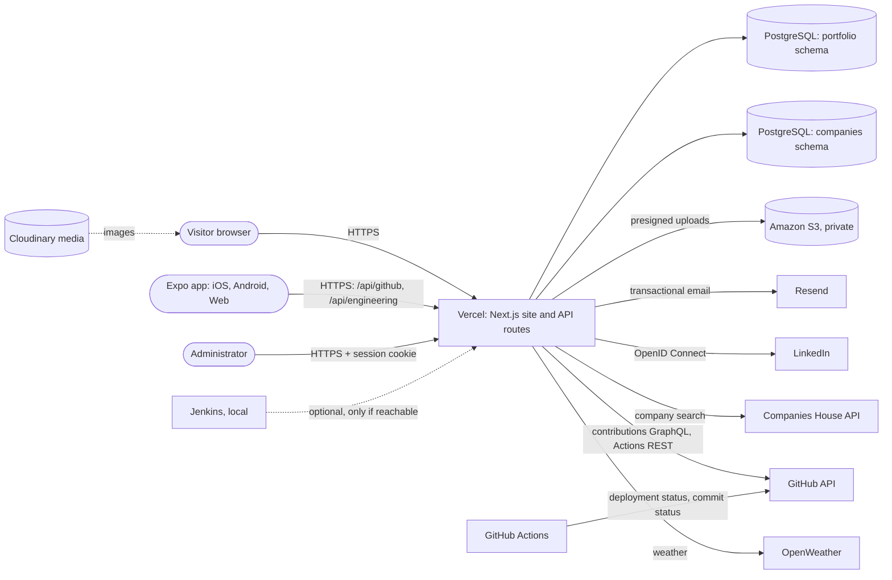
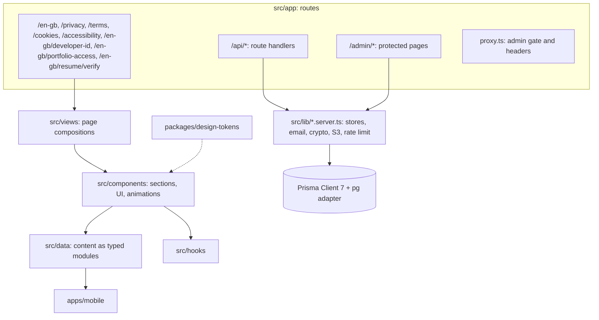
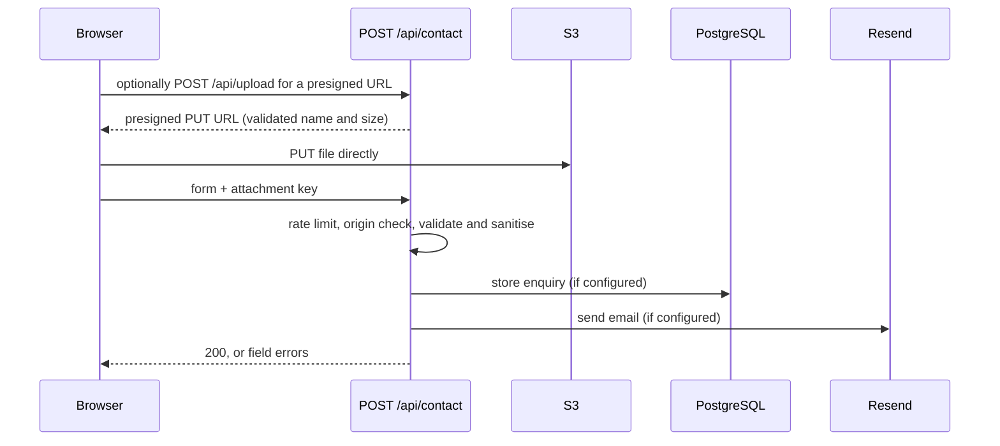
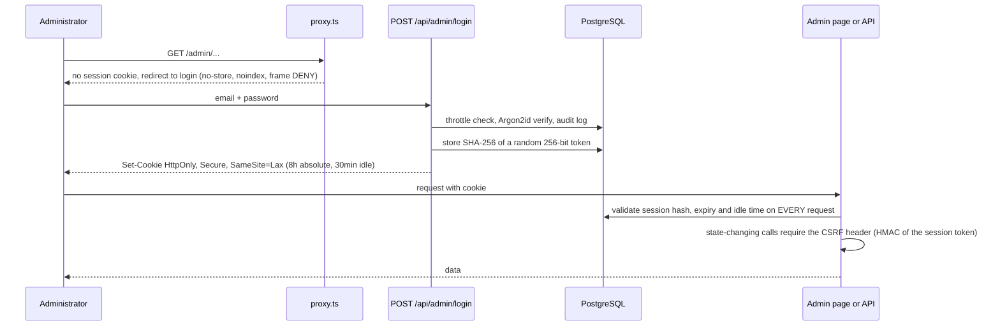
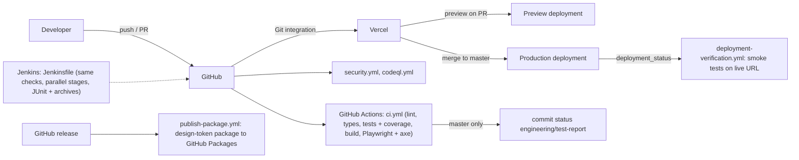

# Architecture

This describes what the repository contains today. File paths are real; diagrams are Mermaid and render on GitHub.

## Overview

An npm-workspaces monorepo:

| Path | What it is |
|---|---|
| `src/` | The website: Next.js (App Router), React, TypeScript, plain scoped CSS. |
| `apps/mobile/` | The companion app: Expo / React Native (iOS, Android, Expo Web). Imports the website's content from `src/data`; it does not duplicate it. |
| `packages/design-tokens/` | `@domwokorach/dw-professional-design-tokens`: the light and dark CSS tokens, published to GitHub Packages by `publish-package.yml` on a GitHub release. |
| `prisma/` | Two Prisma schemas: the portfolio database (`prisma/schema.prisma`) and the company directory (`prisma/company/schema.prisma`). |
| `tests/`, `.github/workflows/`, `Jenkinsfile` | Automated quality assurance and delivery (see below). |

## System context

Optional integrations are off until their environment variables exist; each one reports itself unavailable
instead of failing the page.

## Components of the web application

- **App Router**: `/` redirects to `/en-gb` (`next.config.ts`). The home page is statically generated and revalidated;
  dynamic data (comments, GitHub activity, engineering status) loads from API routes after render.
- **Styling**: plain CSS per section (`src/styles/*.css`) over the tokens in `base.css`; no Tailwind.
- **Server/browser boundary**: server code lives in `*.server.ts`; a test (`tests/resume-unit.test.ts`) fails if browser code imports it.
- **Shared types**: `src/lib/github/types.ts` and `src/lib/engineering/types.ts` are used by the website, the API routes and the Expo app.

## Data

Two PostgreSQL schemas, each with its own Prisma config and migrations (`prisma.config.ts`, `prisma.company.config.ts`):

- `portfolio`: `ContactMessage`, `Media`, `Comment`, `AdminUser`, `AdminSession`, `AdminAuditLog`, `AdminLoginAttempt`,
  `PortfolioAccess`, `PortfolioAccessFile`, `ResumeAccess`, `ResumeEvent`, `ResumeFile`.
- `companies`: `Company` (imported from Companies House bulk data; see `docs/COMPANIES.md`).

Migrations are applied by hand after review (`npm run db:deploy`, `npm run companies:migrate`); builds only run `prisma generate`.

## Data flow: contact enquiry (representative)

## Authentication and authorisation

There are no public accounts. The only authenticated area is `/admin` (single administrator role).

`proxy.ts` is only the first gate (it checks that a cookie exists); every admin page and API re-validates against the
database in `src/lib/admin/session.server.ts`. Visitors can optionally import their name and email through LinkedIn
OpenID Connect (`src/lib/linkedin.server.ts`): random `state` and `nonce`, sealed in a short-lived cookie, validated on
the callback. Résumé access uses emailed PINs and links with keyed hashes and constant-time comparison.

## Live engineering status

`GET /api/engineering/status` (`src/lib/engineering/status.server.ts`) reads GitHub's REST API server-side with a 5s
timeout and a 5-minute cache, and backs off after a rate limit while serving the last good answer flagged `stale`.
Jenkins is contacted only when `JENKINS_URL` and `JENKINS_JOB` are set; otherwise it is `not_configured`, and an unreachable
Jenkins is `unavailable`. Test and coverage numbers come from a commit status (`engineering/test-report`) that CI
writes from the real JUnit and coverage files. If it is absent, the site shows no numbers. No credential reaches the client.

## Delivery

- **GitHub Actions** (`.github/workflows/`): `ci`, `security`, `codeql`, `accessibility`, `deployment-verification`, `publish-package`.
  Least-privilege permissions, actions pinned to SHAs, concurrency groups, npm cache.
- **Jenkins** (`Jenkinsfile`): a second, self-hosted runner for the same gates. It is not exposed publicly.
- **Vercel**: deployment only; see [DEPLOYMENT.md](DEPLOYMENT.md), including rollback.
- **Quality gates**: ESLint, TypeScript for web and Expo, unit/integration/component tests with coverage thresholds,
  Playwright end-to-end and axe accessibility, `npm audit`, CodeQL. See [TESTING.md](TESTING.md), [ACCESSIBILITY.md](ACCESSIBILITY.md) and [../SECURITY.md](../SECURITY.md).

## Source versus published

The design-token package exists in source (`packages/design-tokens`) and has a publish workflow triggered by a GitHub
release. Whether a given version is *published* to GitHub Packages is a property of the registry, not of the source;
check the repository's Packages tab. This document makes no claim about it.
